# Лабораторна робота 2. Створення складних SQL запитів

## Загальна інформація

- **Здобувач освіти:** Самойло Тарас Костянтинович
- **Група:** ІПЗ-32
- **Обраний рівень складності:** 2
- **СУБД:** PostgreSQL (Supabase), навчальна база даних з ЛР1

Мета роботи: набути практичних навичок створення складних SQL запитів для аналізу даних: з'єднання таблиць, агрегатні функції, групування, підзапити, віконні функції, аналіз планів виконання.

Усі запити зібрано у файлі [`lab02-queries.sql`](lab02-queries.sql).

### Навчальна база даних

| Таблиця | Рядків | Призначення |
|---|---|---|
| categories | 10 | категорії товарів |
| suppliers | 8 | постачальники |
| products | 25 | товари |
| regions | 25 | регіони |
| customers | 15 | клієнти (`individual` / `company`) |
| employees | 8 | співробітники, ієрархія через `reports_to` |
| orders | 31 | замовлення за 15.01.2024 – 20.08.2024 |
| order_items | 47 | позиції замовлень (`discount` від 0.00 до 0.20) |

Сума позиції замовлення в усіх запитах рахується як `quantity * unit_price * (1 - discount)`.

---

# РІВЕНЬ 1

## 1. З'єднання таблиць

### 2.1 INNER JOIN: товари з назвами категорій та постачальників

```sql
SELECT p.product_name, c.category_name, s.company_name, p.unit_price
FROM products p
INNER JOIN categories c ON p.category_id = c.category_id
INNER JOIN suppliers s ON p.supplier_id = s.supplier_id
ORDER BY c.category_name, p.product_name;
```

Результат: 25 рядків. Кожен товар має і категорію, і постачальника, тому INNER JOIN нічого не відкинув.

Складність: низька. Два хеш-з'єднання, O(n) за кількістю товарів.

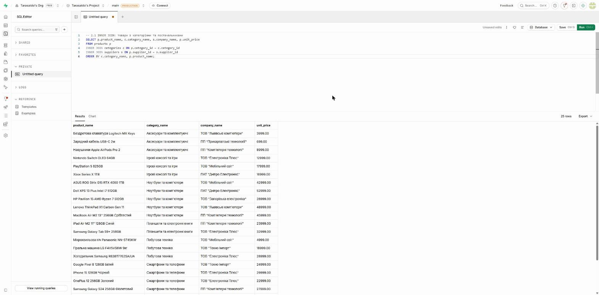

### 2.2 LEFT JOIN: усі клієнти, включно з тими, хто не має замовлень

```sql
SELECT c.contact_name, c.customer_type, r.region_name,
       COUNT(o.order_id) AS order_count
FROM customers c
LEFT JOIN orders o ON c.customer_id = o.customer_id
LEFT JOIN regions r ON c.region_id = r.region_id
GROUP BY c.customer_id, c.contact_name, c.customer_type, r.region_name
ORDER BY order_count DESC;
```

Результат: 15 клієнтів. Найбільше замовлень у Петрова Івана Миколайовича (3), у решти по 2. Клієнтів без замовлень у базі немає. Якби такий клієнт був, LEFT JOIN залишив би його з `order_count = 0`, бо `COUNT(o.order_id)` не рахує NULL.

Складність: низька. З'єднання та групування за ключем клієнта.

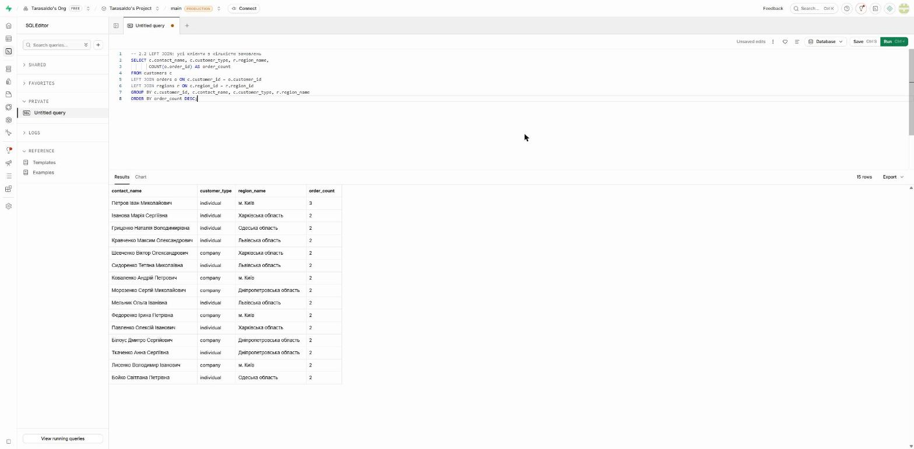

### 2.3 Множинне з'єднання (6 таблиць): деталі доставлених замовлень

```sql
SELECT o.order_id, o.order_date,
       cu.contact_name AS customer,
       e.last_name || ' ' || e.first_name AS employee,
       p.product_name, c.category_name,
       oi.quantity, oi.unit_price, oi.discount,
       ROUND(oi.quantity * oi.unit_price * (1 - oi.discount), 2) AS line_total
FROM orders o
JOIN customers cu   ON o.customer_id = cu.customer_id
JOIN employees e    ON o.employee_id = e.employee_id
JOIN order_items oi ON o.order_id = oi.order_id
JOIN products p     ON oi.product_id = p.product_id
JOIN categories c   ON p.category_id = c.category_id
WHERE o.order_status = 'delivered'
ORDER BY o.order_date, o.order_id;
```

Результат: 39 позицій доставлених замовлень. Для кожної видно клієнта, менеджера, товар, категорію, знижку та суму позиції. Наприклад, замовлення №7 (Білоус Д. С.): 3 × Lenovo ThinkPad X1 зі знижкою 12% = 129 357.36 грн.

Складність: середня. 5 з'єднань. Фільтр `order_status = 'delivered'` застосовується до `orders` ще до з'єднань, тому в з'єднаннях бере участь менше рядків.

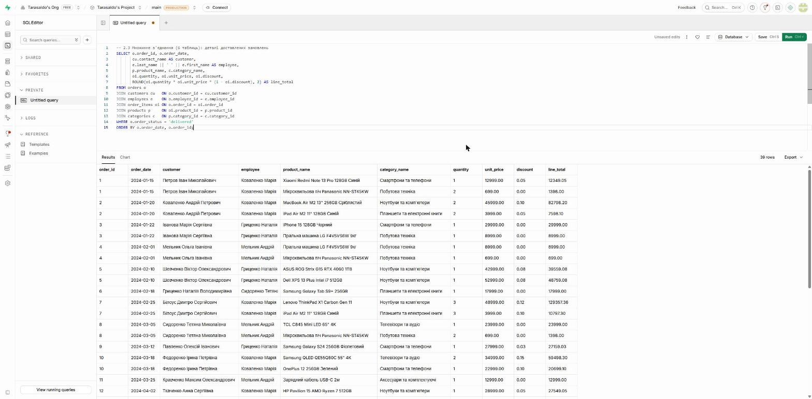

## 2. Агрегатні функції

### 3.1 Кількість товарів у кожній категорії та ціни (COUNT, AVG, MIN, MAX)

```sql
SELECT c.category_name,
       COUNT(p.product_id) AS product_count,
       ROUND(AVG(p.unit_price), 2) AS avg_price,
       MIN(p.unit_price) AS min_price,
       MAX(p.unit_price) AS max_price
FROM categories c
LEFT JOIN products p ON c.category_id = p.category_id
GROUP BY c.category_id, c.category_name
ORDER BY product_count DESC;
```

Результат: 10 категорій. Найбільше товарів у «Ноутбуки та комп'ютери» та «Смартфони та телефони» (по 5). Найвища середня ціна у «Телевізори та аудіо» (48 749 грн). Три категорії («Спортивні технології», «Фото та відео», «Розумний дім») не мають товарів: для них `COUNT = 0`, а `AVG/MIN/MAX = NULL`.

Складність: низька.

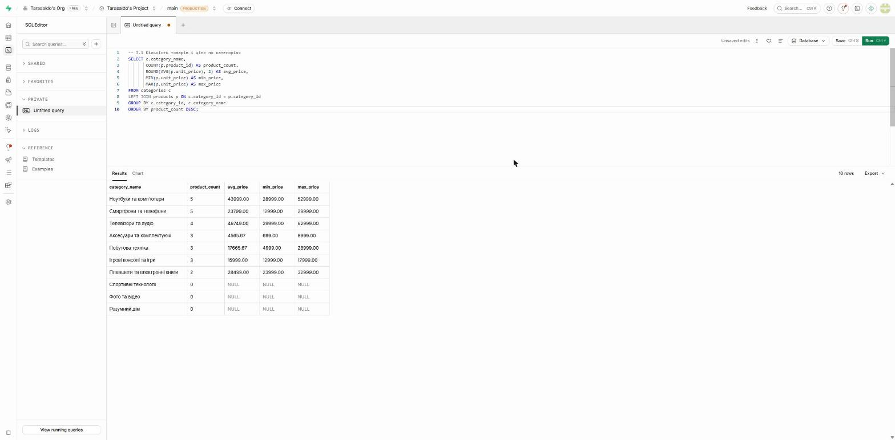

### 3.2 Загальні продажі за регіонами (SUM, GROUP BY, HAVING)

```sql
SELECT r.region_name,
       COUNT(DISTINCT o.order_id) AS orders_count,
       SUM(oi.quantity) AS items_sold,
       ROUND(SUM(oi.quantity * oi.unit_price * (1 - oi.discount)), 2) AS total_sales,
       ROUND(AVG(oi.quantity * oi.unit_price * (1 - oi.discount)), 2) AS avg_line_value
FROM regions r
JOIN customers cu   ON cu.region_id = r.region_id
JOIN orders o       ON o.customer_id = cu.customer_id
JOIN order_items oi ON oi.order_id = o.order_id
WHERE o.order_status <> 'pending'
GROUP BY r.region_id, r.region_name
HAVING COUNT(DISTINCT o.order_id) >= 2
ORDER BY total_sales DESC;
```

Результат (без замовлень у статусі `pending`, лише регіони з ≥ 2 замовленнями):

| Регіон | Замовлень | Товарів | Продажі, грн |
|---|---|---|---|
| м. Київ | 8 | 31 | 872 462.56 |
| Дніпропетровська обл. | 5 | 28 | 683 365.95 |
| Харківська обл. | 6 | 18 | 333 315.00 |
| Одеська обл. | 4 | 4 | 90 796.05 |
| Львівська обл. | 6 | 13 | 64 062.75 |

`WHERE` відкидає рядки до групування, `HAVING` відкидає групи після нього.

Складність: середня. 3 з'єднання, агрегація, `COUNT(DISTINCT)` потребує сортування.

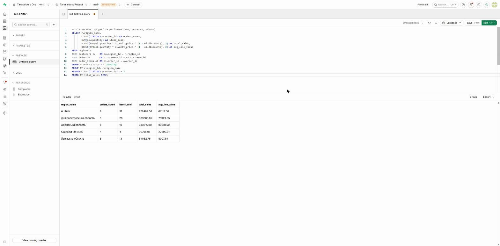

### 3.3 Постачальники з кількістю товарів більше 2

```sql
SELECT s.company_name,
       COUNT(p.product_id) AS products_count,
       ROUND(AVG(p.unit_price), 2) AS avg_price,
       SUM(p.units_in_stock) AS total_in_stock
FROM suppliers s
JOIN products p ON p.supplier_id = s.supplier_id
GROUP BY s.supplier_id, s.company_name
HAVING COUNT(p.product_id) > 2
ORDER BY products_count DESC;
```

Результат: 4 постачальники з 8. ТОВ «Електроніка Плюс» (6 товарів), ПП «Комп'ютерні технології» (5), ТОВ «Мобільний світ» (4), ТОВ «Техно Імпорт» (3).

Складність: низька.

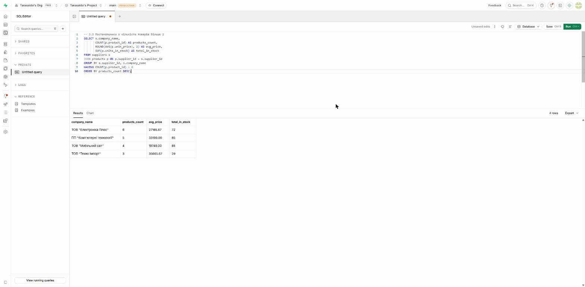

## 3. Базові підзапити

### 4.1 Корельований підзапит у WHERE: товари дорожчі за середню ціну у своїй категорії

```sql
SELECT p.product_name, p.unit_price, c.category_name
FROM products p
INNER JOIN categories c ON p.category_id = c.category_id
WHERE p.unit_price > (
    SELECT AVG(p2.unit_price)
    FROM products p2
    WHERE p2.category_id = p.category_id
)
ORDER BY c.category_name, p.unit_price DESC;
```

Результат: 14 товарів. Наприклад, у категорії «Ноутбуки та комп'ютери» (середня ціна 43 999 грн) це Dell XPS 13, Lenovo ThinkPad X1 і MacBook Air M2.

Складність: середня. Підзапит виконується для кожного рядка зовнішнього запиту, O(n·m). Як оптимізувати: обчислити середні один раз через CTE з `GROUP BY category_id` або віконною функцією `AVG(unit_price) OVER (PARTITION BY category_id)`.

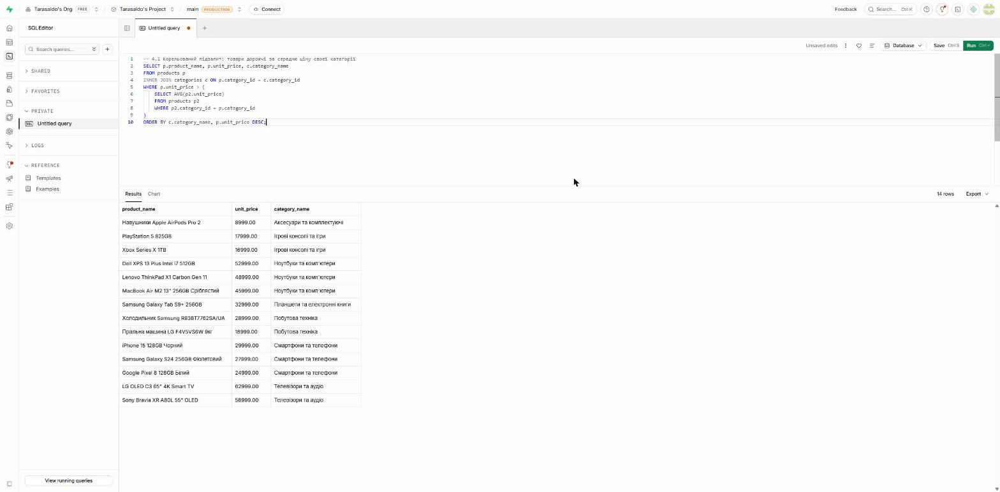

### 4.2 Підзапит з IN: клієнти, які мали замовлення у 2024 році

```sql
SELECT customer_id, contact_name, city, customer_type
FROM customers
WHERE customer_id IN (
    SELECT customer_id
    FROM orders
    WHERE order_date >= '2024-01-01' AND order_date < '2025-01-01'
)
ORDER BY contact_name;
```

Результат: 15 клієнтів, тобто всі клієнти бази робили замовлення у 2024 році. Фільтр за датою задано діапазоном, а не через `EXTRACT(YEAR ...)`, тому може використовуватися індекс `idx_orders_date`.

Складність: низька. Підзапит некорельований, тому виконується лише один раз, а не для кожного рядка.

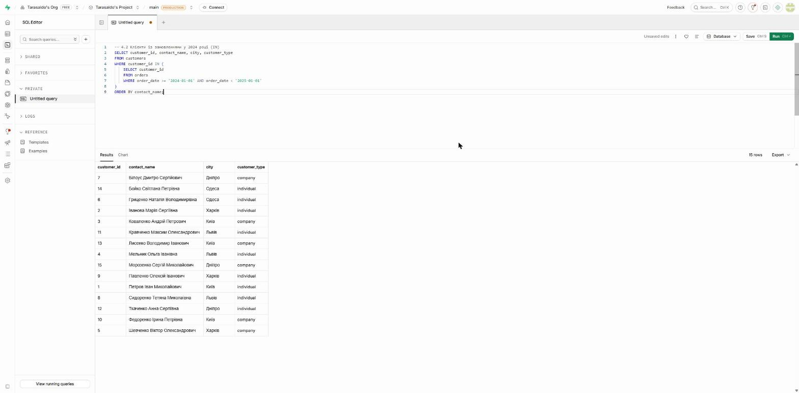

### 4.3 Підзапит з NOT EXISTS: товари, які жодного разу не продавались

```sql
SELECT p.product_id, p.product_name, p.unit_price, p.units_in_stock
FROM products p
WHERE NOT EXISTS (
    SELECT 1 FROM order_items oi WHERE oi.product_id = p.product_id
)
ORDER BY p.product_name;
```

Результат: 4 товари без жодного продажу: Nintendo Switch OLED, PlayStation 5, Xbox Series X і клавіатура Logitech MX Keys. Це кандидати на акцію або перегляд асортименту.

Складність: низька. PostgreSQL виконує `NOT EXISTS` як anti-join (одне з'єднання замість перевірки для кожного рядка). На відміну від `NOT IN`, він коректно працює, коли в підзапиті трапляються NULL.

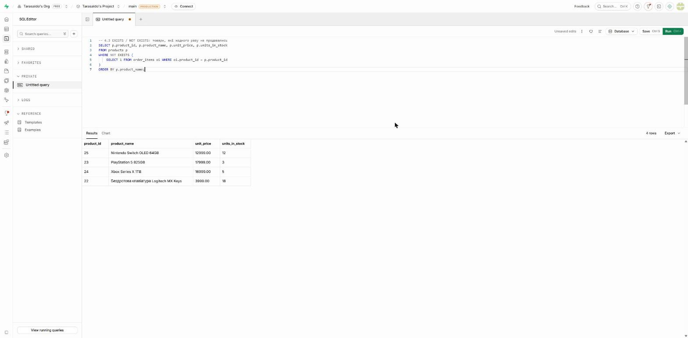

### 4.4 Підзапити у SELECT: загальна кількість продажів кожного товару

```sql
SELECT p.product_name, p.unit_price,
       (SELECT COALESCE(SUM(oi.quantity), 0)
          FROM order_items oi WHERE oi.product_id = p.product_id) AS total_sold,
       (SELECT COUNT(DISTINCT oi.order_id)
          FROM order_items oi WHERE oi.product_id = p.product_id) AS orders_count,
       (SELECT ROUND(AVG(unit_price), 2) FROM products) AS avg_price_all
FROM products p
ORDER BY total_sold DESC, p.product_name;
```

Результат: 25 товарів. Лідери продажів: iPad Air M2 (19 шт. у 5 замовленнях), MacBook Air M2 (15 шт.), мікрохвильова піч Panasonic (13 шт.). Скалярний підзапит `avg_price_all` дає середню ціну по всьому каталогу (27 907 грн).

Складність: висока відносно задачі. Два корельовані підзапити виконуються по 25 разів кожен. Оптимізований варіант див. у пункті 7.3.

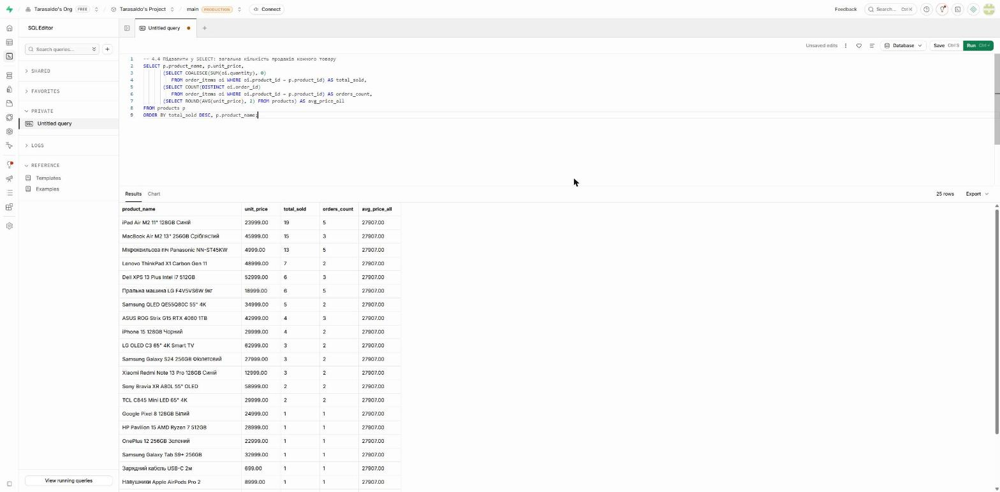

---

# РІВЕНЬ 2

## 4. Складні з'єднання

### 5.1 RIGHT JOIN: категорії товарів та їх наявність

```sql
SELECT c.category_name,
       COUNT(p.product_id) AS products_count,
       COALESCE(ROUND(AVG(p.unit_price), 2), 0) AS avg_price
FROM products p
RIGHT JOIN categories c ON p.category_id = c.category_id
GROUP BY c.category_id, c.category_name
ORDER BY products_count DESC;
```

Результат: усі 10 категорій. Для трьох порожніх `COALESCE` замінює NULL на 0. Результат такий самий, як у 3.1 з `categories LEFT JOIN products`: RIGHT JOIN завжди можна переписати як LEFT JOIN, помінявши таблиці місцями.

Складність: низька.

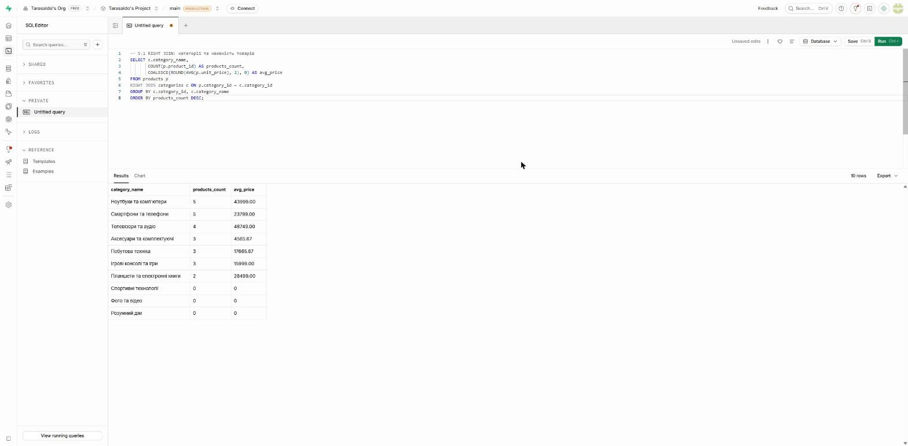

### 5.2 FULL OUTER JOIN: усі категорії та всі товари

```sql
SELECT c.category_name, p.product_name, p.unit_price,
       CASE WHEN p.product_id IS NULL THEN 'категорія без товарів'
            WHEN c.category_id IS NULL THEN 'товар без категорії'
            ELSE 'є зв''язок' END AS link_status
FROM categories c
FULL OUTER JOIN products p ON c.category_id = p.category_id
ORDER BY (p.product_id IS NULL OR c.category_id IS NULL) DESC, c.category_name, p.product_name;
```

Результат: 28 рядків, тобто 25 товарів і 3 категорії без товарів (вони відсортовані на початок). Товарів без категорії немає. FULL OUTER JOIN зручний для перевірки цілісності даних: одним запитом видно «сиріт» з обох боків.

Складність: низька (Hash Full Join).

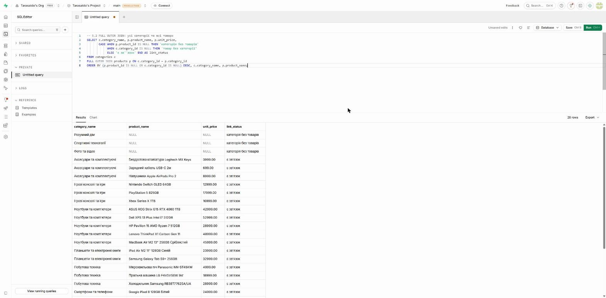

### 5.3 Self-join: співробітники та їх керівники

```sql
SELECT e1.first_name || ' ' || e1.last_name AS employee,
       e1.title AS employee_title,
       e2.first_name || ' ' || e2.last_name AS manager,
       e2.title AS manager_title
FROM employees e1
LEFT JOIN employees e2 ON e1.reports_to = e2.employee_id
ORDER BY e2.last_name NULLS FIRST, e1.last_name;
```

Результат: 8 співробітників. Олександр Петренко (генеральний директор) не має керівника (NULL). Йому підпорядковуються Сергій Іваненко, Марія Коваленко та Ольга Шевченко. Дмитро Білоус і Тетяна Сидоренко звітують Іваненку, а Наталія Гриценко й Андрій Мельник звітують Коваленко. LEFT JOIN потрібен, щоб директор не зник з результату.

Складність: низька. Таблиця з'єднується сама з собою через псевдоніми `e1`/`e2`, індекс `idx_employees_reports_to`.

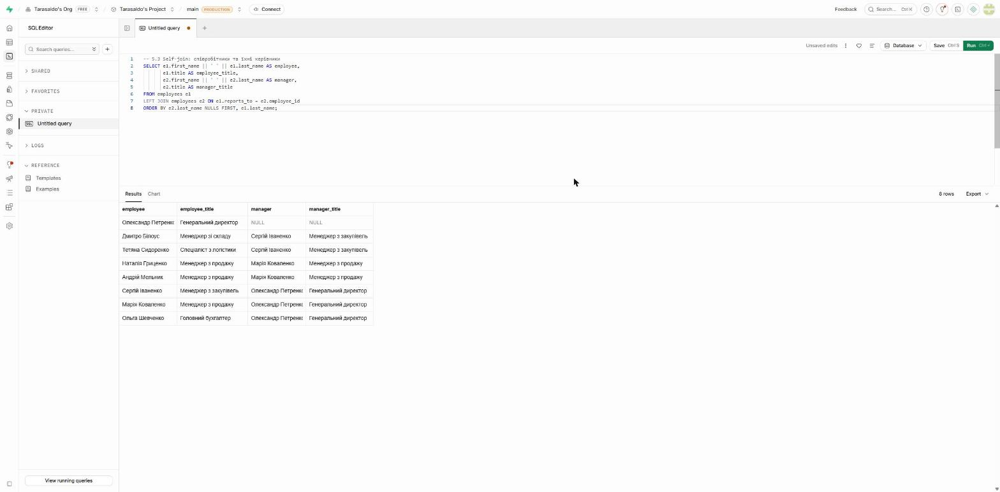

### 5.4 Умовне з'єднання (додаткові умови в ON)

```sql
SELECT cu.contact_name, cu.customer_type,
       COUNT(o.order_id) AS delivered_since_march,
       COALESCE(SUM(o.freight), 0) AS freight_sum
FROM customers cu
LEFT JOIN orders o
       ON o.customer_id = cu.customer_id
      AND o.order_status = 'delivered'
      AND o.order_date >= '2024-03-01'
GROUP BY cu.customer_id, cu.contact_name, cu.customer_type
ORDER BY delivered_since_march DESC, cu.contact_name;
```

Результат: 15 клієнтів з кількістю доставлених з 01.03.2024 замовлень і сумою доставки. Білоус Дмитро Сергійович залишився в списку з 0, хоча таких замовлень у нього немає. Якби умови `order_status` і `order_date` стояли у `WHERE`, LEFT JOIN фактично перетворився б на INNER JOIN і цей клієнт зник би з результату.

Складність: низька.

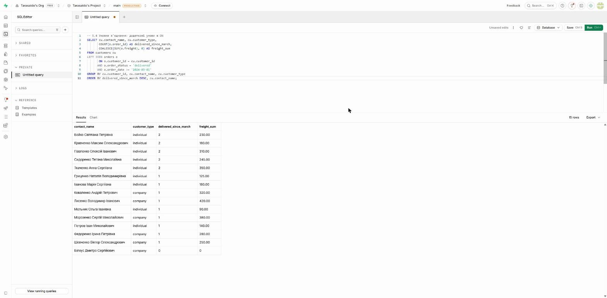

## 5. Віконні функції та аналітика

### 5.5 ROW_NUMBER(), RANK(), DENSE_RANK(): ранжування товарів за ціною в категорії

```sql
SELECT p.product_name, c.category_name, p.unit_price,
       RANK()       OVER (PARTITION BY c.category_name ORDER BY p.unit_price DESC) AS price_rank,
       DENSE_RANK() OVER (PARTITION BY c.category_name ORDER BY p.unit_price DESC) AS price_dense_rank,
       ROW_NUMBER() OVER (PARTITION BY c.category_name ORDER BY p.unit_price DESC) AS row_num
FROM products p
JOIN categories c ON p.category_id = c.category_id
ORDER BY c.category_name, p.unit_price DESC;
```

Результат: нумерація починається з 1 у кожній категорії (`PARTITION BY`). Однакових цін у межах категорії немає, тому всі три функції дали однакові значення. Щоб показати різницю між ними, нижче виконано додатковий запит.

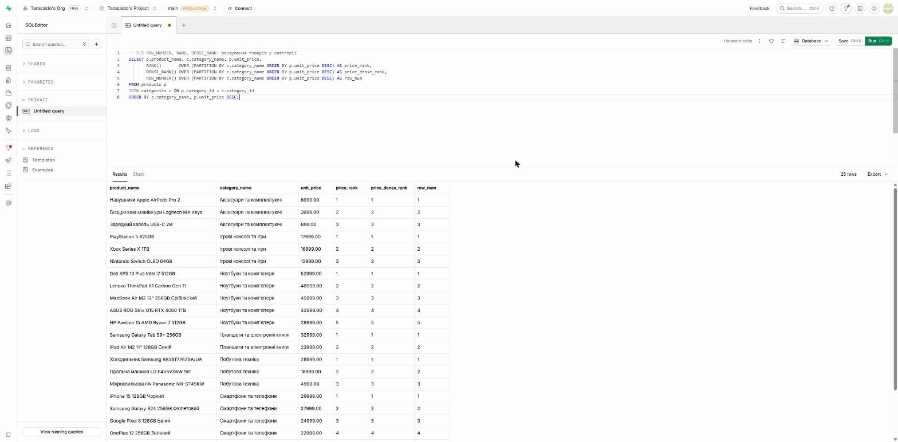

### 5.5б Різниця RANK / DENSE_RANK / ROW_NUMBER при однакових значеннях

```sql
SELECT p.product_name,
       COALESCE(SUM(oi.quantity), 0) AS total_sold,
       ROW_NUMBER() OVER (ORDER BY COALESCE(SUM(oi.quantity), 0) DESC) AS row_num,
       RANK()       OVER (ORDER BY COALESCE(SUM(oi.quantity), 0) DESC) AS sold_rank,
       DENSE_RANK() OVER (ORDER BY COALESCE(SUM(oi.quantity), 0) DESC) AS sold_dense_rank
FROM products p
LEFT JOIN order_items oi ON oi.product_id = p.product_id
GROUP BY p.product_id, p.product_name
ORDER BY total_sold DESC, p.product_name;
```

Результат: Dell XPS 13 та пральна машина LG продали по 6 шт.

| Товар | Продано | ROW_NUMBER | RANK | DENSE_RANK |
|---|---|---|---|---|
| Dell XPS 13 | 6 | 5 | 5 | 5 |
| Пральна машина LG | 6 | 6 | 5 | 5 |
| Samsung QLED 55" | 5 | 7 | **7** | **6** |

`ROW_NUMBER` завжди дає унікальні номери. `RANK` дає однаковий ранг рівним значенням і пропускає наступний номер (після 5, 5 іде 7). `DENSE_RANK` пропусків не робить (після 5, 5 іде 6).

Складність: середня. Агрегація плюс сортування для вікна, O(n log n).

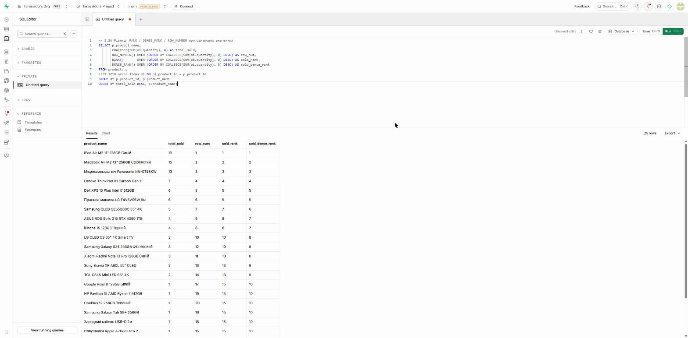

### 5.6 LAG() та LEAD(): порівняння замовлення клієнта з попереднім

```sql
WITH order_totals AS (
    SELECT o.order_id, o.customer_id, o.order_date,
           ROUND(SUM(oi.quantity * oi.unit_price * (1 - oi.discount)), 2) AS order_total
    FROM orders o
    JOIN order_items oi ON oi.order_id = o.order_id
    GROUP BY o.order_id, o.customer_id, o.order_date
)
SELECT cu.contact_name, t.order_id, t.order_date, t.order_total,
       LAG(t.order_total)  OVER w AS prev_total,
       t.order_total - LAG(t.order_total) OVER w AS diff_vs_prev,
       t.order_date - LAG(t.order_date) OVER w AS days_since_prev,
       LEAD(t.order_date)  OVER w AS next_order_date
FROM order_totals t
JOIN customers cu ON cu.customer_id = t.customer_id
WINDOW w AS (PARTITION BY t.customer_id ORDER BY t.order_date, t.order_id)
ORDER BY cu.contact_name, t.order_date;
```

Результат: 31 замовлення. Для кожного показано суму попереднього замовлення того ж клієнта, різницю сум, кількість днів між замовленнями та дату наступного. Наприклад, Білоус Д. С. купив на 140 154.66 грн 25.02.2024, а через 172 дні на 321 586.80 грн (+181 432.14). Для першого замовлення клієнта `LAG` повертає NULL, для останнього NULL повертає `LEAD`. Іменоване вікно `WINDOW w` прибирає дублювання опису вікна.

Складність: середня. CTE з агрегацією та одне сортування для вікна.

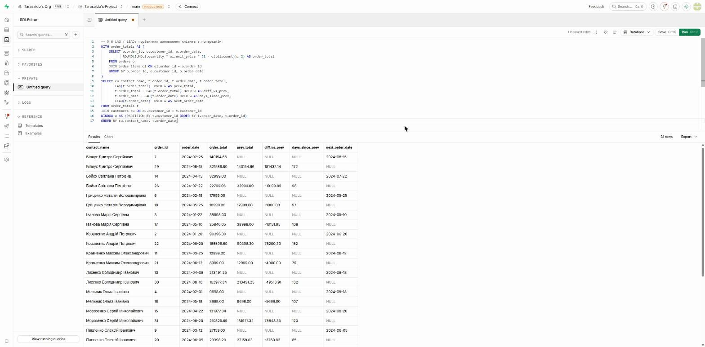

### 5.7 PARTITION BY: аналіз продажів співробітників у розрізі місяців

```sql
WITH monthly AS (
    SELECT o.employee_id,
           DATE_TRUNC('month', o.order_date)::date AS month,
           SUM(oi.quantity * oi.unit_price * (1 - oi.discount)) AS revenue
    FROM orders o
    JOIN order_items oi ON oi.order_id = o.order_id
    GROUP BY o.employee_id, DATE_TRUNC('month', o.order_date)
)
SELECT m.month,
       e.last_name || ' ' || e.first_name AS employee,
       ROUND(m.revenue, 2) AS revenue,
       RANK() OVER (PARTITION BY m.month ORDER BY m.revenue DESC) AS rank_in_month,
       ROUND(100 * m.revenue / SUM(m.revenue) OVER (PARTITION BY m.month), 1) AS pct_of_month,
       ROUND(SUM(m.revenue) OVER (PARTITION BY m.employee_id ORDER BY m.month), 2) AS employee_running_total
FROM monthly m
JOIN employees e ON e.employee_id = m.employee_id
ORDER BY m.month, rank_in_month;
```

Результат: 23 рядки (співробітник × місяць). В одному запиті використано два різні розрізи:
- `PARTITION BY month` дає місце співробітника в місяці та його частку від виручки місяця. Наприклад, у квітні Коваленко Марія принесла 92% виручки;
- `PARTITION BY employee_id ORDER BY month` дає накопичувальну виручку співробітника з початку року.

Складність: середня. Три віконні функції з різними вікнами вимагають кількох сортувань.

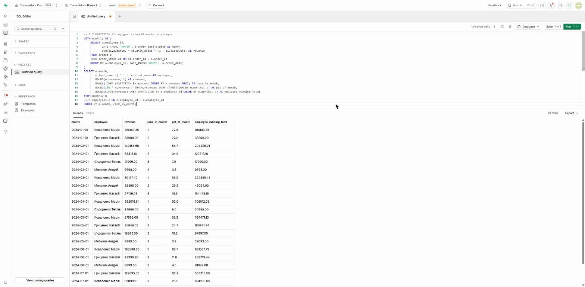

---

## 6. Аналіз продуктивності

### 7.1 Наявні індекси

```sql
SELECT tablename, indexname, indexdef
FROM pg_indexes
WHERE schemaname = 'public'
ORDER BY tablename, indexname;
```

Результат: 24 індекси. Крім первинних ключів, у ЛР1 вже створено індекси на всі зовнішні ключі (`idx_order_items_order`, `idx_order_items_product`, `idx_orders_customer`, `idx_orders_employee`, `idx_products_category`, `idx_products_supplier`, `idx_employees_reports_to`), а також на `orders(order_date)`, `orders(order_status)` і `products(unit_price)`.

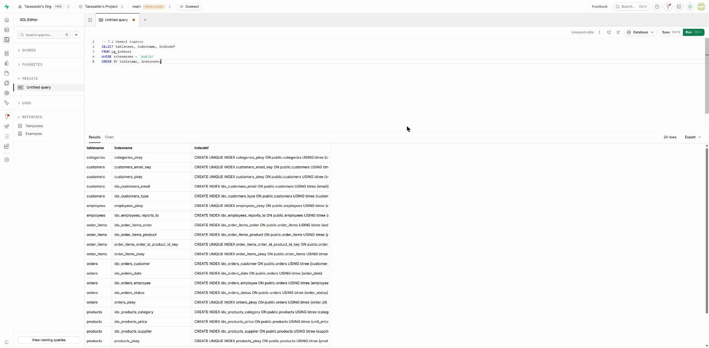

### 7.2 EXPLAIN ANALYZE найповільнішого запиту (корельовані підзапити, 4.4)

```sql
EXPLAIN (ANALYZE, BUFFERS)
SELECT p.product_name, p.unit_price,
       (SELECT COALESCE(SUM(oi.quantity), 0)
          FROM order_items oi WHERE oi.product_id = p.product_id) AS total_sold,
       (SELECT COUNT(DISTINCT oi.order_id)
          FROM order_items oi WHERE oi.product_id = p.product_id) AS orders_count
FROM products p
ORDER BY total_sold DESC;
```

Що видно у плані:
- `SubPlan 1` і `SubPlan 2` виконуються з `loops=25`, тобто кожен підзапит запускається для кожного товару;
- щоразу виконується `Seq Scan on order_items` (`Rows Removed by Filter: 45`);
- загальна оцінена вартість `cost=82.27`, `Buffers: shared hit=57`, фактичний час 0.436 мс.

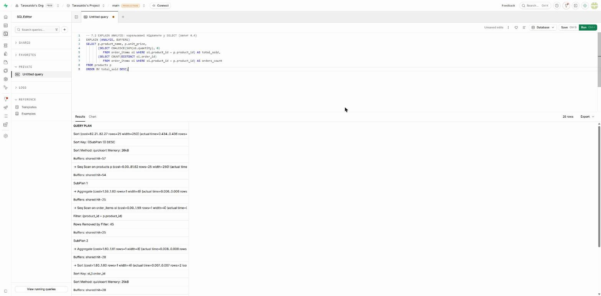

### 7.3 Оптимізація: заміна корельованих підзапитів на JOIN + GROUP BY

```sql
EXPLAIN (ANALYZE, BUFFERS)
SELECT p.product_name, p.unit_price,
       COALESCE(SUM(oi.quantity), 0) AS total_sold,
       COUNT(DISTINCT oi.order_id) AS orders_count
FROM products p
LEFT JOIN order_items oi ON oi.product_id = p.product_id
GROUP BY p.product_id, p.product_name, p.unit_price
ORDER BY total_sold DESC;
```

План: один `Hash Right Join`, `GroupAggregate` і `Sort`. Кожна таблиця читається лише раз.

| Показник | 7.2 (підзапити) | 7.3 (JOIN) |
|---|---|---|
| Оцінена вартість | 82.27 | **5.84** |
| Buffers (shared hit) | 57 | **8** |
| Фактичний час вузла верхнього рівня | 0.436 мс | **0.199 мс** |
| Проходів по order_items | 50 | **1** |

Оцінена вартість зменшилась приблизно в 14 разів. На реальних обсягах (тисячі товарів, мільйони позицій) різниця була б ще більшою, бо кількість проходів по `order_items` у варіанті з підзапитами росте лінійно з кількістю товарів.

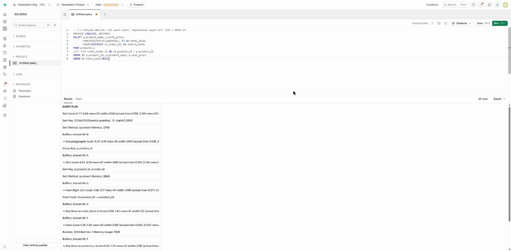

### 7.4 Створення індексів для покращення продуктивності

```sql
CREATE INDEX IF NOT EXISTS idx_orders_customer_date ON orders(customer_id, order_date);
CREATE INDEX IF NOT EXISTS idx_order_items_product_cover ON order_items(product_id) INCLUDE (quantity, order_id);
ANALYZE orders;
ANALYZE order_items;

-- на 25-47 рядках планувальник обирає Seq Scan, тому для демонстрації вимикаємо його
SET enable_seqscan = off;
EXPLAIN (ANALYZE, BUFFERS)
SELECT order_id, order_date
FROM orders
WHERE customer_id = 1
ORDER BY order_date;
```

Навіщо ці індекси:
- `idx_orders_customer_date (customer_id, order_date)`: складений індекс для запитів «історія замовлень клієнта» і для вікна `PARTITION BY customer_id ORDER BY order_date` (запит 5.6). У плані видно `Index Scan using idx_orders_customer_date` без окремого вузла `Sort`, бо рядки вже йдуть з індексу відсортованими за датою. Час виконання 0.047 мс.
- `idx_order_items_product_cover (product_id) INCLUDE (quantity, order_id)`: покриваючий індекс для запитів 4.4 і 7.3, що підсумовують продажі за товаром. З ним можливий Index Only Scan без звернення до самої таблиці.

Зауваження. У навчальній базі 25–47 рядків на таблицю, і вся таблиця вміщується в одну сторінку пам'яті. Тому планувальник справедливо вважає `Seq Scan` дешевшим, і щоб побачити використання індексу, довелося тимчасово вимкнути `enable_seqscan`. На великих таблицях індекси використовуються автоматично.

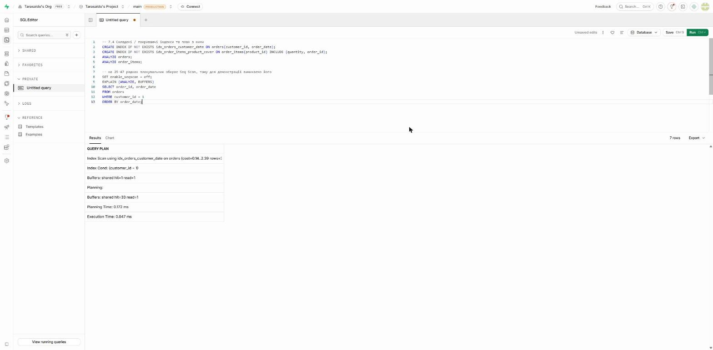

### Оцінка складності та способи оптимізації

| Запит | Складність | Вузьке місце | Як оптимізувати |
|---|---|---|---|
| 2.1, 2.2, 3.1, 3.3, 5.1–5.4 | низька | — | індекси на зовнішні ключі (вже є) |
| 2.3 (6 таблиць) | середня | кількість з'єднань | фільтрувати `orders` по статусу/даті до з'єднань (`idx_orders_status`, `idx_orders_date`), вибирати лише потрібні стовпці |
| 3.2 (регіони) | середня | `COUNT(DISTINCT)`, 3 з'єднання | матеріалізоване представлення з денними/місячними підсумками |
| 4.1 (корельований WHERE) | середня | підзапит на кожен рядок | CTE з `AVG ... GROUP BY category_id` або `AVG() OVER (PARTITION BY category_id)` |
| 4.2, 4.3 (IN / EXISTS) | низька | — | діапазон дат замість функцій над стовпцем; `NOT EXISTS` замість `NOT IN` |
| 4.4 (підзапити у SELECT) | висока | N × 2 проходи по `order_items` | переписати через JOIN + GROUP BY (див. 7.3), покриваючий індекс |
| 5.5–5.7 (віконні) | середня | сортування для кожного різного вікна | однакові вікна через `WINDOW`, складені індекси під `PARTITION BY ... ORDER BY` |

---

## Відповіді на контрольні запитання

**1. В чому різниця між INNER JOIN та LEFT JOIN? Коли доцільно використовувати кожен з них в контексті навчальної бази даних?**

INNER JOIN повертає лише ті рядки, для яких знайдено відповідність в обох таблицях. LEFT JOIN повертає всі рядки лівої таблиці, а там, де відповідності немає, заповнює стовпці правої таблиці значенням NULL. INNER JOIN доречний, коли зв'язок обов'язковий: товар → категорія, позиція → замовлення (запити 2.1, 2.3). LEFT JOIN потрібен, коли треба бачити всі записи головної таблиці, навіть «порожні»: категорії без товарів (3.1, там `COUNT = 0`), клієнти без замовлень (2.2), директор без керівника (5.3).

**2. Чому не можна використовувати WHERE для фільтрації результатів агрегатних функцій? Яка роль HAVING при аналізі продажів товарів?**

WHERE виконується до GROUP BY, коли груп і агрегатів ще немає. Тому `WHERE SUM(...) > X` спричиняє помилку. HAVING виконується після групування і фільтрує вже готові групи за значенням агрегатів. У запиті 3.2 `WHERE o.order_status <> 'pending'` відкидає окремі замовлення, а `HAVING COUNT(DISTINCT o.order_id) >= 2` залишає лише регіони з достатньою кількістю замовлень. У 3.3 `HAVING COUNT(p.product_id) > 2` відбирає постачальників з більш ніж двома товарами. Умови, що не залежать від агрегатів, краще ставити у WHERE: тоді групується менше рядків.

**3. Як працюють корельовані підзапити і чим вони відрізняються від звичайних? Наведіть приклад для знаходження товарів з ціною вище середньої по категорії.**

Звичайний підзапит не залежить від зовнішнього запиту і виконується один раз, наприклад `WHERE customer_id IN (SELECT customer_id FROM orders ...)` у 4.2. Корельований підзапит посилається на стовпці зовнішнього запиту і логічно виконується для кожного його рядка. У плані це видно як `SubPlan` з `loops = N` (див. 7.2). Приклад (запит 4.1):

```sql
SELECT p.product_name, p.unit_price
FROM products p
WHERE p.unit_price > (SELECT AVG(p2.unit_price)
                      FROM products p2
                      WHERE p2.category_id = p.category_id);
```

Для кожного товару `p` обчислюється середня ціна саме його категорії. Результат: 14 товарів.

**4. В яких ситуаціях доцільно використовувати віконні функції замість GROUP BY при аналізі замовлень клієнтів?**

Тоді, коли потрібно зберегти кожен рядок і водночас показати поруч агрегат або порівняння з іншими рядками. GROUP BY «згортає» рядки в один на групу. Типові випадки:
- порівняння замовлення з попереднім чи наступним замовленням клієнта (LAG/LEAD, запит 5.6);
- накопичувальні суми (running total, 5.7);
- частка замовлення від суми клієнта чи місяця (`SUM() OVER (PARTITION BY ...)`);
- рейтинги та «топ-N у кожній групі» (ROW_NUMBER/RANK, 5.5).

**5. Що таке матеріалізовані представлення і які переваги вони дають для аналітичних запитів по продажах у навчальній базі даних?**

Матеріалізоване представлення (`CREATE MATERIALIZED VIEW`) зберігає на диску результат запиту, а не лише його текст, як звичайне VIEW. Переваги для аналітики продажів:
- важкий запит з 5–6 з'єднаннями та агрегацією (наприклад, місячні продажі за категоріями й регіонами) виконується один раз, а звіти потім читають готову невелику таблицю;
- на представлення можна створювати індекси;
- воно зменшує навантаження на робочі таблиці.

Недолік: дані не оновлюються автоматично, потрібно виконувати `REFRESH MATERIALIZED VIEW` (з опцією `CONCURRENTLY`, якщо є унікальний індекс). Тому такі представлення підходять для звітів, де допустима затримка, наприклад оновлення раз на добу.

**6. Як можна оптимізувати запити з множинними з'єднаннями таблиць orders, order_items, products, customers для покращення продуктивності?**

- Створити індекси на всі стовпці з'єднань: `order_items(order_id)`, `order_items(product_id)`, `orders(customer_id)` (у базі вони вже є).
- Створити складені індекси під типові фільтри та сортування: `orders(customer_id, order_date)`, покриваючі індекси з `INCLUDE` (див. 7.4).
- Фільтрувати якомога раніше: умови на `orders` (дата, статус) ставити так, щоб вони зменшували набір до з'єднання з `order_items`. Умови для зовнішнього з'єднання писати в `ON`.
- Вибирати лише потрібні стовпці замість `SELECT *`.
- Не застосовувати функції до індексованих стовпців у WHERE (`order_date >= '2024-01-01'` замість `EXTRACT(YEAR FROM order_date) = 2024`).
- Корельовані підзапити замінювати на JOIN + GROUP BY (у 7.2/7.3 вартість упала з 82.27 до 5.84).
- Регулярні важкі звіти виносити в матеріалізовані представлення, оновлювати статистику (`ANALYZE`) і перевіряти плани через `EXPLAIN (ANALYZE, BUFFERS)`.

**7. Яка різниця між RANK() та DENSE_RANK() при ранжуванні товарів за ціною? Наведіть приклад з конкретними даними.**

Обидві функції присвоюють однакові ранги однаковим значенням. Різниця в тому, що йде далі. RANK() пропускає номери на кількість рівних рядків, а DENSE_RANK() продовжує нумерацію без пропусків. Приклад із запиту 5.5б (ранжування за кількістю продажів):

| Товар | Продано | RANK | DENSE_RANK |
|---|---|---|---|
| Dell XPS 13 | 6 | 5 | 5 |
| Пральна машина LG | 6 | 5 | 5 |
| Samsung QLED 55" | 5 | 7 | 6 |

Для цін: 1000, 800, 800, 600 RANK дасть 1, 2, 2, 4, а DENSE_RANK дасть 1, 2, 2, 3. ROW_NUMBER у будь-якому разі дає 1, 2, 3, 4.

---

## Висновок

У ході лабораторної роботи на навчальній базі даних PostgreSQL у Supabase виконано завдання рівнів 1 і 2:
- з'єднання таблиць INNER, LEFT, RIGHT і FULL OUTER JOIN, самоз'єднання та з'єднання з додатковими умовами в ON;
- агрегатні функції COUNT/SUM/AVG/MIN/MAX з GROUP BY і HAVING;
- підзапити у WHERE та SELECT, корельовані підзапити, оператори IN та EXISTS;
- віконні функції ROW_NUMBER, RANK, DENSE_RANK, LAG, LEAD з різними PARTITION BY.

За допомогою `EXPLAIN (ANALYZE, BUFFERS)` знайдено найповільніший запит (корельовані підзапити в SELECT, `loops=25`). Після переписування через JOIN + GROUP BY його оцінена вартість зменшилась приблизно в 14 разів. Також створено складений і покриваючий індекси та показано їх використання у плані виконання. Висновок: на малих таблицях PostgreSQL обирає послідовне сканування, а користь від індексів і правильної структури запиту проявляється зі зростанням обсягу даних.
